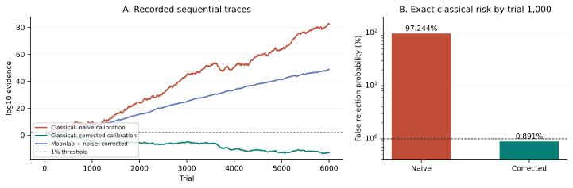

# Contextuality Evidence Lab

**A classical device makes a miscalibrated “1%” test reject 97.24% of the time.
The bias-aware test stays below 1%. The correction and an explicit attack are checked in Lean 4.**

[Interactive lab](https://0thernes.github.io/contextuality-evidence-lab/) ·
[Scientific paper](https://0thernes.github.io/contextuality-evidence-lab/paper/) ·
[PDF](https://0thernes.github.io/contextuality-evidence-lab/paper/whitepaper.pdf) ·
[Formal proof boundary](lean/README.md) · [Versioned release](https://github.com/0thernes/contextuality-evidence-lab/releases/tag/v1.0.0)

This is an AI-assisted research methods artifact: a sharp setting-bias bound for
the Peres–Mermin square, a finite adaptive-tree evidence theorem, an exact
counterexample to incorrect calibration, and an operational Tsotchke experiment.
It combines established mathematics in a reproducible implementation. Historical
priority, external peer review, a famous open-problem solution, hardware
contextuality, and certified quantum randomness are **not established**.

## The experiment

The classical adversary assigns +1 to all nine observables. It fails only the
last of six contexts. That context is chosen with probability 1/12; each other
context has probability 11/60. Its exact success probability is therefore 11/12.

A naive test calibrated as if settings were uniform assumes a success cap of
5/6. The corrected test uses the actual guaranteed setting floor 1/12.

| Result | Naive calibration | Corrected calibration |
|---|---:|---:|
| Claimed false-rejection limit | 1% | 1% |
| Exact false-rejection probability by 1,000 IID classical trials | **97.2443815%** | **0.8907211%** |
| First crossing in the recorded 6,000-trial classical replay | Trial 36 | Never |
| Win / loss factors | 57/50 and 3/10 | 57/55 and 3/5 |

The first row states the test's advertised limit; the naive advertisement is
invalid for this biased device. The probabilities are exact rational absorbing
dynamic-program calculations, not estimated rejection rates. Independent
small-horizon exhaustive path tests validate the recurrence. The independent
artifact checker replays 18,000 trial/test combinations with integer arithmetic.



The native Moonlab run recorded **5,813 successful contexts out of 6,000** after
1% independent per-observable readout flips under the declared software model.
It crossed the corrected threshold at **trial 237**. All 6,000 ideal parities
before flips and 768 additional state probes passed. These are classical
simulation results, not observations of a quantum apparatus.

## What Lean proves

The project has **39 authored theorems**, with **61 proposition-valued
declarations** in the exhaustive transitive axiom audit. Only `propext`,
`Classical.choice`, and `Quot.sound` occur. No admitted proofs, added project
axioms, or `native_decide` are used.

- The minimum failure probability of a classical global value table is exactly
  the least context-selection probability. Every context has a table failing
  only there.
- A conditional setting floor β gives success at most 1−β. An explicitly modeled
  exceptional fraction δ yields 1−(1−δ)β.
- Ideal Pauli observables have the exact within-context commutations and signed
  products used by the experiment.
- For every finite adaptive binary tree with real branch probabilities and
  nonnegative factors of conditional mean at most one, the probability of ever
  reaching threshold T is at most starting wealth/T. Early leaves represent
  arbitrary stopping.
- The exact all-+1 assignment and displayed biased distribution give over 4.3%
  false crossings in the explicit 36-round naive stopped test at nominal 1%.

The theorem requires the probability floor **conditional on the past and the
device's hidden information**, plus one context-independent value table within
each trial. A transcript or setting histogram cannot establish those physical
assumptions. A deliberately context-leaking attacker is included: it wins every
trial and also crosses the corrected threshold because it violates the model.
The formal theorem concerns every finite tree; infinite-horizon measure theory
and the implementation of Python, C, WASM and Eshkol are outside it.

## What the four tools do

| Tool | Executed role |
|---|---|
| Moonlab | Native two-qubit WASM gates, sequential Pauli measurements and collapse; recorded shot outcomes |
| QGTL | Actual Fubini–Study and Berry-curvature C kernels with analytic, independent numerical and gauge checks |
| quantum_rng | Seeded classical software draws, rejection sampling for discrete choices, same-build replay |
| Eshkol | Independent exact enumeration of 512 assignments, all six singleton witnesses and six sharp biased-setting examples |

All four are required by `scripts/run_stack.py`. A missing component or failed
check fails the run and replaces any stale native pass report with a failure.
The analysis binds successful native execution to source/artifact fingerprints
and verifies each full shot against its compact trial. Hashes detect mismatched
records; they do not authenticate a physical producer or make a seeded mixer
independent of an adversary.

## Reproduce

Python 3.9+ and Node 22+ suffice for the exact checks and replay of committed
native evidence:

```sh
python -m unittest discover -s tests -v
python scripts/run_experiment.py
python scripts/verify_artifact.py
node tests/demo.test.mjs
python scripts/serve.py
```

Open `http://127.0.0.1:8837`. The server binds to localhost and supplies explicit
module MIME types, including on Windows. Do not run verification with Python
`-O`: the scripts deliberately fail rather than disable checks.

For a fresh four-tool experiment, install NumPy, GCC, Node and Eshkol, then:

```sh
python scripts/run_stack.py
python scripts/run_experiment.py
python scripts/verify_artifact.py
```

Set `ESHKOL_RUN` or pass `--eshkol-run` for a nonstandard Eshkol installation.
See [the native integration instructions](src/stack_README.md) and
[pinned provenance](third_party/README.md). The published execution was on Windows.
Same-build seeded replay was tested. Cross-platform QRNG byte equality is not
claimed because the upstream software uses floating-point/libm operations.

For Lean, install elan and use the pinned toolchain/manifest:

```sh
cd lean
lake exe cache get
lake build --wfail
lake env lean Verification.lean
```

For paper rendering, install Matplotlib and the development Node packages:

```sh
python scripts/make_figures.py
npm install
npx playwright install chromium
npm run paper
```

The PDF and HTML include locally rendered KaTeX mathematics and local fonts;
they require no external mathematics service. To test the browser interface,
serve it and run `node tests/browser.test.mjs`; set `LAB_URL` for a different
port. An installed browser can be selected using `BROWSER_CHANNEL=msedge`.

GitHub CI rebuilds Lean, audits its axioms, runs the Python and browser-model
tests, and independently replays the committed native evidence. CI does not
claim to rerun the locally installed four-tool stack. Pages publication follows
a successful verification workflow.

## Evidence and publication

- [Scientific methods paper](paper/whitepaper.md) and [bounded prior-art review](research/PRIOR_ART.md).
- [Exact benchmark and traces](results/experiment.json).
- [Native execution report](results/stack_report.json) and [raw shot records](results/stack_shots.json).
- [Independent replay report](results/independent_verification.json).
- [Formal build and axiom audit](lean/reports/verification-summary.json).
- [Publication status and limitations](publication/STATUS.md).

This is a methods paper with a literature synthesis, not a statistical
meta-analysis: no independent empirical studies are pooled. The Peres–Mermin
construction, prediction-based-ratio ideas and finite maximal inequality are
established work, cited in the paper. The user requested the research direction;
AI agents generated and cross-checked code, proofs, analysis and prose. No human
referee or institution is represented as having reviewed or endorsed the work.
