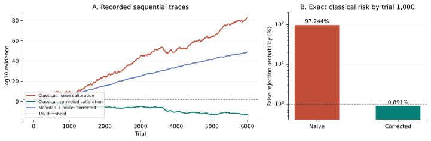

# Contextuality Evidence Lab: Exact Sequential Certificates and a Constructive Setting-Bias Attack

0thernes · AI-assisted research artifact  
AI-assisted research software and methods preprint · 10 November 2026  
Manuscript status: research preprint, version 1.0.0. Not externally peer reviewed.

## Abstract

A contextuality inequality can be mathematically correct while the reported evidence against a classical model is invalid. We construct an executable benchmark in which a biased setting distribution makes a conventional uniform-setting analysis falsely reject a context-independent classical assignment. For the six contexts of the Peres–Mermin square, a lower bound \(\beta\) on each context's conditional selection probability gives the sharp success bound \(1-\beta\). Nonnegative rational test factors satisfying that bound yield a finite-tree threshold-crossing guarantee under arbitrary adaptive inter-trial memory. The concrete benchmark uses \(\beta=1/12\): protected factors are \(57/55\) on success and \(3/5\) on failure, while incorrectly assuming uniform settings gives factors \(57/50\) and \(3/10\). Under an explicit classical biased-setting model, 36 initial successes occur with probability \((11/12)^{36}>0.01\), yet the incorrect evidence exceeds 100. Thus its claimed one-percent error guarantee fails by an exact finite calculation. At horizon 1,000, exact rational dynamic programming gives false-rejection probabilities approximately 97.24% and 0.8907% for the incorrect and protected analyses, respectively. The companion implementation connects formal certificates, exact replay, simulated quantum measurements, software sampling, independent enumeration, and state-geometry checks. The result is an auditable methods artifact. It is not a new contextuality inequality, a hardware experiment, a proof of physical randomness, or a solution to a famous open problem.

## 1. Research question and contribution

The question is operational: can a reader verify both a contextuality score and the assumptions under which that score has statistical meaning?

The project studies the gap between a deterministic inequality and a stream of finite experimental records. Its central example is deliberately small enough that every hidden-value assignment can be inspected. The mathematical result is an exact contract: if a context-selection floor holds after conditioning on the information available to the classical device, and the device uses a context-independent value assignment within each trial, then a specified evidence process has a controlled threshold-crossing probability. The associated attack violates a stronger, incorrectly assumed selection floor while preserving the weaker declared one.

The ingredients have substantial prior art. The Peres–Mermin construction is established quantum-foundations mathematics [1]. Prediction-based-ratio methods already handle dependence on past experimental data [2]. Contextuality-witness optimization by linear programming is established [3]. The threshold-crossing principle is a finite form of Ville's inequality [5]. Our contribution is a concrete formal and executable integration, including an exact counterexample to a misconfigured analysis. The bounded literature review in `research/PRIOR_ART.md` does not establish historical priority.

This is a methods paper with a critical literature synthesis. It is not a statistical meta-analysis: no collection of independent experimental studies is pooled, and no pooled effect size or heterogeneity estimate is reported.

## 2. Finite experiment and null model

### 2.1 Context-independent values

Place nine dichotomic observables in a three-by-three square. A deterministic classical assignment gives one value \(a_{ij}\in\{-1,+1\}\) to each cell. The six contexts are the three rows and three columns. Each context has a prescribed operator-product sign \(\sigma_c\), with

\[
\prod_{c=1}^{6}\sigma_c=-1.
\]

The executable realization, using ordinary two-qubit Pauli words, is

\[
\begin{pmatrix}
XI&IX&XX\\
IZ&ZI&ZZ\\
XZ&ZX&YY
\end{pmatrix}.
\]

All three row products and the first two column products are \(+I\); the final column product is \(-I\). Contexts are indexed 0 through 5 in that order. The all-\(+1\) classical assignment therefore fails only context 5.

The signed classical response and success indicator are

\[
y_c(a)=\sigma_c\prod_{(i,j)\in c}a_{ij},
\qquad
W_c(a)=\mathbf 1\{y_c(a)=+1\}.
\]

Every cell occurs in two contexts. Consequently

\[
\prod_{c=1}^{6}y_c(a)
=\left(\prod_c\sigma_c\right)\prod_{i,j}a_{ij}^2
=-1. \tag{1}
\]

At least one context therefore fails. This finite parity fact, not any statistical approximation, is the source of the classical bound.

The null permits randomized mixtures of the 512 assignments. It also permits a different assignment on every trial, selected using the entire previous history. It does not permit the within-trial value of the same observable to depend on the selected context. Allowing arbitrary such dependence removes the parity obstruction.

### 2.2 Conditional setting floor

Let \(H_{t-1}\) denote the observed history before trial \(t\), and let \(\Lambda_t\) include the classical device's internal state and proposed assignment. Require

\[
\Pr(C_t=c\mid H_{t-1},\Lambda_t)\ge\beta
\quad\text{for every }c, \qquad 0<\beta\le1/6. \tag{2}
\]

This is a conditional assumption. An approximately balanced histogram does not prove it. Nor does a secret-looking software seed prove it against a device that knows the seed. A deterministic mixer is useful for reproducible software tests but does not certify measurement independence or physical entropy.

The stronger value \(\beta=1/6\) forces the conditional distribution to be exactly uniform. The weaker \(\beta=1/12\) permits substantial bias while retaining a nontrivial guarantee.

### 2.3 Physical interpretation

The null is a model of deterministic context-independent values, their mixtures, and adaptive memory between trials. It is not the entire class of generalized-noncontextual ontological models for arbitrary noisy operational procedures. The distinction matters because deriving experimentally robust generalized-noncontextuality inequalities requires additional preparation and measurement structure [4]. Sequential measurement compatibility, apparatus calibration, detection losses, setting independence, and the relation between recorded data and physical observables require separate experimental justification.

The software experiment below runs on a classical computer. Its simulated quantum data can violate the specified classical model without constituting a physical refutation of that model in nature.

## 3. Exact theorems

### Theorem 1. Sharp weighted classical bound

For context probabilities \(p_1,\ldots,p_6\), with nonnegative entries summing to one,

\[
\max_a\sum_{c=1}^{6}p_cW_c(a)=1-\min_c p_c. \tag{3}
\]

**Proof.** Equation (1) supplies a failed context, so the failure probability is at least \(\min_c p_c\). To attain the bound, choose an assignment failing only a context of minimum probability. Such an assignment exists for each context: prescribed row and column products can be realized whenever the product of the three desired row products equals the product of the three desired column products. Changing exactly one of the six inconsistent target signs restores that compatibility condition. One can choose the upper-left four cell values freely, fill the final cell of each of the first two rows and columns to meet their targets, and then fill the last cell; the compatibility condition guarantees the last target. The implementation also exhausts all 512 assignments. Mixtures cannot exceed a maximum over their deterministic components. ∎

Combining (2) with (3) gives the conditional success bound

\[
\Pr(W_t=1\mid H_{t-1})\le b:=1-\beta. \tag{4}
\]

The conditioning on the device's internal state in (2) allows the assignment and the context probabilities to vary together, provided the floor holds for each resulting state. Averaging then gives (4).

**Optional contamination model.** Suppose the context-independent model applies on a conditional fraction at least \(1-\delta\) of trials, and the setting floor applies conditional on that good component; the remaining component is unrestricted. Then

\[
\Pr(W_t=1\mid H_{t-1})\le1-(1-\delta)\beta. \tag{5}
\]

This follows by allowing success probability one on the unrestricted component. A bound on \(\delta\) is an additional assumption, not something inferred from the observed success rate. The main numerical benchmark uses \(\delta=0\).

### Theorem 2. Safe one-step test factors

Let \(0<b<1\), choose \(q\in[b,1]\) before observing the current trial, and define

\[
A=q/b,\qquad B=(1-q)/(1-b),\qquad
F_t=\begin{cases}A,&W_t=1,\\B,&W_t=0.\end{cases} \tag{6}
\]

For every conditional success probability \(p\le b\),

\[
\mathbb E[F_t\mid H_{t-1}]
=pA+(1-p)B
\le bA+(1-b)B=1. \tag{7}
\]

**Proof.** The factors are nonnegative. Their difference is
\(A-B=(q-b)/(b(1-b))\ge0\), so the affine expression in \(p\) is maximized at \(b\). Substitution gives one. ∎

More generally, the proof only needs \(A,B\ge0\) and \(pA+(1-p)B\le1\) at each possible history. Factors may be adapted to earlier trials. A choice that uses the current outcome before committing the factors is outside this condition.

### Theorem 3. Finite-horizon crossing guarantee

Start with \(E_0=1\), and multiply the factors: \(E_t=\prod_{s=1}^{t}F_s\). For every finite horizon \(N\) and threshold \(T>0\),

\[
\Pr\{\exists t\le N:E_t\ge T\}\le 1/T. \tag{8}
\]

This holds for arbitrary history-dependent conditional success probabilities and factors obeying (7). Identically distributed trials and independent outcomes are not required.

**Finite-tree proof.** Represent the experiment as a binary tree, with a distinct conditional probability and factor pair at each node. Stop a branch at its first crossing. At a crossing node, its wealth is at least \(T\); thus \(T\) times its hit indicator is at most its wealth. At an unhit terminal node, the indicator is zero. Working backward, multiply the bounds for the two children by their nonnegative branch probabilities and add. The one-step condition says that their expected wealth is at most the parent's wealth. Induction reaches the root and gives \(T\Pr(\text{hit by }N)\le1\). ∎

Equation (8) is a finite instance of the classical nonnegative-supermartingale maximal bound [5]. The formal certificate deliberately uses a finite tree rather than assuming a measure-theoretic library theorem. Any bounded, history-dependent stopping rule is covered by the crossing event. Extending the interpretation to an unbounded stochastic process requires the usual probability-space consistency and continuity argument; that extension is not needed to verify any finite experimental trace in this release.

For reporting, \(\min(1,1/\max_{s\le t}E_s)\) is an upper bound valid under this sequential model. It is not the probability that the null hypothesis is true.

## 4. Constructive falsification of a uniform-setting analysis

Choose a context \(c_*\), a fixed assignment failing only \(c_*\), and independent context choices with

\[
p_{c_*}=1/12,
\qquad p_c=11/60\quad(c\ne c_*). \tag{9}
\]

All contexts meet the declared floor \(1/12\). This is a classical context-independent device with success probability exactly \(11/12\).

Take the common forecast \(q=19/20\). The protected and incorrect configurations are:

| Analysis | Assumed bound \(b\) | Success factor \(A\) | Failure factor \(B\) | Mean factor under (9) |
|---|---:|---:|---:|---:|
| Protected floor \(\beta=1/12\) | \(11/12\) | \(57/55\) | \(3/5\) | \(1\) |
| Incorrect uniform assumption | \(5/6\) | \(57/50\) | \(3/10\) | \(107/100\) |

The incorrect process violates the key condition before any sampling occurs. A specific finite counterexample makes the consequence explicit:

\[
(57/50)^{36}>100,
\qquad
(11/12)^{36}>1/100. \tag{10}
\]

Therefore the probability that it crosses 100 by trial 36 is at least

\[
(11/12)^{36}\approx0.0436125829,
\]

already more than four times the claimed one-percent error budget. This lower bound counts only the event of 36 initial successes; it does not rely on a simulated unlucky run. On that same all-success trace, protected wealth is only \((57/55)^{36}\approx3.61774525\). Its uniform crossing guarantee remains one percent at threshold 100.

For the fixed independent model (9), the incorrect log-wealth drift is

\[
\frac{11}{12}\log(57/50)+\frac1{12}\log(3/10)
\approx0.01977817>0. \tag{11}
\]

Thus long runs can accumulate increasingly strong but invalid apparent evidence. The protected drift is negative for this same null model; its arithmetic mean factor remains one. The difference between mean factor and mean log factor is relevant when interpreting individual traces.

## 5. Quantum simulation and readout model

Within each ideal quantum context, the three commuting observables multiply to the prescribed sign times the identity. Sequential projective measurements therefore have signed product +1 on every input state, assuming the intended operators and ideal measurement rules.

The benchmark corrupts each recorded binary outcome independently with probability \(\varepsilon=1/100\), after the simulated measurement. With three outcomes per context, an even number of flips preserves the parity. The success probability is exactly

\[
q_{\mathrm{noise}}
=(1-\varepsilon)^3+3\varepsilon^2(1-\varepsilon)
=\frac{1+(1-2\varepsilon)^3}{2}
=0.970596. \tag{12}
\]

This is a synthetic readout-corruption model. It does not model coherent gate error, a changed quantum state update, correlated detector noise, loss, or context-dependent disturbance. The forecast \(q=0.95\) is deliberately distinct from the model probability; validity depends on the null bound, while the forecast affects power.

Under independent draws from (12), the protected expected log growth is

\[
q_{\mathrm{noise}}\log(57/55)
+(1-q_{\mathrm{noise}})\log(3/5)
\approx0.01964751
\quad\text{per context trial}. \tag{13}
\]

Equation (13) predicts favorable accumulation of evidence in this simulator model. It is an analytic expectation, not an observed benchmark and not a guarantee that every finite run crosses a threshold.

## 6. Execution architecture and reproducibility

The four requested Tsotchke components have separate roles:

| Component | Role | Evidentiary boundary |
|---|---|---|
| Moonlab | State preparation and sequential Pauli measurements | A classical state-vector simulation, checked against independent operator calculations |
| quantum_rng | Seeded software draws for contexts and measurement/readout choices | Reproducibility and execution coverage; no physical or cryptographic entropy claim |
| Eshkol | Independent enumeration of all classical assignments and the biased classical score | A second implementation of finite arithmetic; not an assumed trusted optimizer |
| QGTL | Quantum-state geometry consistency checks on prepared states | A check of state handling and geometry kernels; it does not prove the statistical null model |

The experiment separates operator identities, finite assignment enumeration, stochastic simulation, and sequential evidence. Hashes identify source files and traces so that a reader can detect changed inputs. Hashes do not show that an original record came from a physical apparatus.

Exact rational arithmetic is used for factor validation and certificate replay. Logarithms serve visualization and approximate rate summaries. A value near a rejection boundary must be decided by the exact arithmetic rather than by a floating-point graph.

### 6.1 Falsification controls

The operator checks reject deliberately changed product signs. The statistical unit tests reject unsafe factors, negative factors, invalid selection floors, incompatible forecasts, and non-Boolean trial outcomes. They also reject declaring the biased distribution (9) to have floor \(1/6\). A separate test compares the absorbing dynamic program with independent enumeration of every binary outcome path at a small horizon. The biased-setting classical construction is a positive control for failure of the incorrect analysis and a negative control for the protected interpretation. These checks do not detect a dishonest producer who replaces an entire transcript and its accompanying hashes.

A classical simulator that receives the selected context and freely chooses different values for the same observable in different contexts can reproduce all six target parities. Such a simulator lies outside the null. Its existence is not a counterexample to Theorem 1; it demonstrates why the null's context-independence assumption cannot be omitted.

### 6.2 Execution records

The native stack record, `results/stack_report.json`, reports successful execution of all four components on Windows with Python 3.9.13, NumPy 2.0.2, Node v25.8.2, GCC 16.1.0, and Eshkol v1.3.6-evolve. The seed is 20261110. These are recorded build conditions, not requirements that those exact versions are scientifically necessary.

| Check | Recorded result | Meaning |
|---|---:|---|
| Classical assignment enumeration | 512 assignments; 96 with one failure, 320 with three, 96 with five | Independent Eshkol and Python implementations recover the parity restriction and sharp examples |
| Six biased setting distributions | Maximum success \(55/60=11/12\) for each | Each context can be the uniquely failed, least-sampled context |
| Ideal preparation probes | 768/768 agreeing context trials | Finite implementation checks across zero, plus, Bell, complex and computational-basis preparations |
| Fresh ideal context trials | 6,000/6,000 successes | The measured simulator parities satisfy the intended operator products |
| Same trials after injected readout flips | 5,813 successes and 187 failures | Observed synthetic-noise success fraction \(5813/6000\approx0.96883333\) |
| Maximum Pauli expectation discrepancy | \(6.66\times10^{-16}\) | Agreement with an independent numerical oracle |
| Repeated-measurement failures | 0 | Finite check of ideal compatible-measurement behavior |
| Wrong-sign controls | Six exact operator-sign mutations and 768 wrong-sign trial predictions rejected | The tests distinguish the intended sign pattern from a deliberately incorrect one |
| QGTL versus analytic geometry | Maximum absolute error \(4.90\times10^{-12}\) | Numerical consistency for the specified state family and finite-difference step |
| QGTL phase-gauge test | Maximum discrepancy \(2.71\times10^{-15}\) | Numerical invariance check; not a formal proof of the library |

The Moonlab run executed 68,337 gate calls and 20,448 projective measurements. The noise routine recorded 189 individual outcome flips; multiple flips in one context explain why this need not equal the count of failed contexts. QGTL used a central-difference step of \(10^{-5}\), and its curvature convention is \(F_{ij}=-2\operatorname{Im}Q_{ij}\). A deliberately reversed curvature sign disagreed by approximately 0.94249, so the geometry test is sensitive to that error.

The software mixer reproduced the same byte stream in a same-build repeat and produced a different stream under a changed seed. These two checks establish repeatability and seed sensitivity for the sampled executions; they are not tests of physical quantum entropy or a general cryptographic security proof.

### 6.3 Exact false-rejection comparison and recorded traces

The release's `results/experiment.json` stores the exact numerator and denominator of each finite-horizon probability. The dynamic program uses integer probability mass and exact threshold comparisons, absorbs each branch on its first crossing, and checks total mass conservation. With fixed factors, wealth depends only on the number of successes and failures, so surviving paths can be combined by their success count. This calculation is for the independent biased classical model (9); the formal guarantee is more general.

| Analysis of the same classical null model | Horizon | Threshold | Probability of at least one crossing |
|---|---:|---:|---:|
| Incorrect uniform-setting analysis | 1,000 | 100 | 0.972443815379754 |
| Protected \(\beta=1/12\) analysis | 1,000 | 100 | 0.008907211340206219 |

The displayed decimals round exact rational results. The incorrect analysis falsely rejects with probability about 97.24% in this benchmark; the protected analysis's probability is about 0.8907%, below its one-percent guarantee. These values are exact finite probability calculations, not estimated frequencies from repeated Monte Carlo runs. The dynamic program was cross-checked against an independently written full outcome-path enumeration at horizon 9. The full horizon-1,000 calculation is executable arithmetic, not itself a newly generated Lean theorem.



**Figure 1.** Evidence trajectories are single seeded realizations, with threshold 100 corresponding to a nominal one-percent guarantee only for a valid model and calibration. The probability comparison is an exact finite-horizon calculation for the specified independent biased classical model, not an estimate from repeated runs. The protected formal bound applies to every valid finite adaptive tree; the displayed independent benchmark illustrates one such null model.

The recorded classical attack uses the all-\(+1\) assignment and a separate disclosed Python standard-library pseudorandom stream with seed 20261110. Its incorrect analysis first crosses threshold 100 at trial 36; the protected analysis never crosses in the 6,000 recorded trials. The noisy Moonlab transcript's protected analysis first crosses at trial 237 and ends with \(\log_{10}E\approx48.68650582\). That is a conditional model-analysis result for simulated data, not evidence that hardware generated quantum outcomes.

A separate context-leak control produces 600 successes by using information excluded by the null. The protected calculation also crosses on that trace, at trial 129. This is an intended boundary demonstration: no statistical certificate can restore a context-independence assumption that the data-generating device violates. The label “protected” refers to the stated selection-floor and memory model, not to arbitrary attacks on acquisition or measurement semantics.

### 6.4 Reproduction sequence

From the repository root, with the dependencies described in `src/stack_README.md`, execute:

```sh
python scripts/run_stack.py
python scripts/run_experiment.py
python scripts/verify_artifact.py
python -m unittest discover -s tests -v
node tests/demo.test.mjs
```

The full stack runner requires the actual four components and fails if one is unavailable. The published vendored inputs and provenance records identify the small Moonlab, QGTL, and quantum_rng components used; Eshkol is an external executable. Record bytes are reproducible in the reported build configuration; cross-platform floating-point and toolchain differences must be checked rather than assumed harmless.

The separate Lean project pins Lean 4.35.0 and mathlib v4.35.0. In `lean/`, run:

```sh
lake exe cache get
lake build
lake env lean Verification.lean
```

The source, manifest, proof statements, generated records, and checks are all part of the reproducibility claim. A reader can independently alter a model parameter, rerun the pipeline, and test whether the claimed guarantee still follows.

## 7. Formal verification boundary

The Lean project successfully checked 39 authored theorems. Its exhaustive audit covered 61 proposition-valued declarations in the `Evidence` namespace, including generated equation lemmas. The final record in `lean/reports/axiom-audit.log` is `AXIOM_AUDIT_COUNT 61`; the only transitive axiom dependencies are the standard foundations `propext`, `Classical.choice`, and `Quot.sound`. The proof source contains no admitted proofs, added project axioms, or `native_decide` proofs. Finite assignment and integer-matrix computations use kernel-checked evaluation.

| Mathematical claim | Selected accepted declarations |
|---|---|
| Every square assignment loses, and each context can be its only loss | `Evidence.square_no_all_win`, `Evidence.square_singleton_witness` |
| Sharp weighted bound and conditional-floor bound | `Evidence.sharp_minimum`, `Evidence.failure_lower_bound`, `Evidence.success_upper_bound` |
| Finite mixtures and explicit exceptional-trial budget | `Evidence.mixture_failure_lower_bound`, `Evidence.defect_success_bound` |
| Ideal Pauli matrices are symmetric involutions, commute within contexts, and have the required products | `Evidence.ideal_observables`, `Evidence.ideal_context_commutation`, `Evidence.ideal_context_product` |
| Safe factors and expected-wealth control | `Evidence.local_factor_bound`, `Evidence.BetTree.expected_wealth_bound` |
| Threshold-crossing bound for every valid finite adaptive tree | `Evidence.BetTree.finite_hitting_bound` |
| Actual square success probabilities produce valid tree nodes | `Evidence.classical_square_node_valid` |
| The released all-\(+1\) assignment and exact biased distribution give false rejection above 4.3% for the naive stopped test | `Evidence.concrete_all_positive_false_positive` |
| Concrete protected-prefix guarantee | `Evidence.protected_prefix_threshold_bound` |

The exact counterexample theorem connects the actual assignment and its context probabilities to an explicit 36-round tree that stops at its first failure. It is stronger than checking two unrelated numerical inequalities. Such a stopped experiment is sufficient to falsify the incorrect one-percent guarantee; a test that continues past failures has at least the same all-success crossing event.

A successful theorem check certifies the stated implications, including every explicit hypothesis. It does not certify that a real experiment satisfies those hypotheses. The ideal matrix results establish algebraic commutation and product identities; the physical behavior of an apparatus and the state-update implementation of the simulator remain separate claims.

The formal finite-tree model uses real branch probabilities and real factors. The released concrete factors and exact replay computations are rational. The tree theorem is finite-horizon and does not formalize an infinite sample space or an unbounded stochastic process.

The project's finite-tree treatment is intentionally specialized. Lean already has substantial formal probability infrastructure and published martingale formalizations [6]. No first-ever formal-probability or e-process claim is made here.

The release record distinguishes three categories: statements checked by Lean's kernel; finite arithmetic and matrix calculations checked by executable code; and external assumptions about experimental meaning. The software stack, compiler, operating system, data acquisition, and physical apparatus are not all formally verified merely because a mathematical certificate is accepted.

## 8. Interpretation and limitations

The benchmark establishes a practical point: certifying the classical score does not by itself certify a statistical conclusion. A setting-distribution mismatch can produce false evidence with no quantum device and no contextual value assignment. An explicit conditional floor repairs this particular error at a calculable cost in sensitivity.

The result does not improve the minimum size of a Kochen–Specker set, discover a new physical interaction, or show a quantum computational speedup. It also does not provide certified random numbers. Its transferable contribution is a reviewable boundary between data generation, mathematical assumptions, exact computation, and statistical reporting.

The present demonstration uses one small scenario and a disclosed synthetic noise model. A hardware deployment would need an operationally justified null, an independently defensible selection-floor bound, calibration and compatibility analysis, treatment of losses, and trustworthy acquisition of all trials. It would also need a plan for calibrating or selecting forecasts without using future outcomes. Those are research and experimental tasks; the software record cannot discharge them by assertion.

The paper is an AI-assisted preprint. Its mathematical proofs and executable certificates are offered for independent examination. Automated checking and agent review are not human peer review, and public availability is not journal acceptance.

## References

1. N. David Mermin. *Simple unified form for the major no-hidden-variables theorems*. Physical Review Letters **65**, 3373–3376 (1990). [doi:10.1103/PhysRevLett.65.3373](https://doi.org/10.1103/PhysRevLett.65.3373).

2. Yanbao Zhang, Scott Glancy, Emanuel Knill. *Asymptotically optimal data analysis for rejecting local realism*. Physical Review A **84**, 062118 (2011). [doi:10.1103/PhysRevA.84.062118](https://doi.org/10.1103/PhysRevA.84.062118); [arXiv:1108.2468v2](https://arxiv.org/abs/1108.2468v2).

3. Matthias Kleinmann, Costantino Budroni, Jan-Åke Larsson, Otfried Gühne, Adán Cabello. *Optimal inequalities for state-independent contextuality*. Physical Review Letters **109**, 250402 (2012). [doi:10.1103/PhysRevLett.109.250402](https://doi.org/10.1103/PhysRevLett.109.250402); [arXiv:1204.3741v2](https://arxiv.org/abs/1204.3741v2).

4. Anirudh Krishna, Robert W. Spekkens, Elie Wolfe. *Deriving robust noncontextuality inequalities from algebraic proofs of the Kochen–Specker theorem: the Peres–Mermin square*. New Journal of Physics **19**, 123031 (2017). [doi:10.1088/1367-2630/aa9168](https://doi.org/10.1088/1367-2630/aa9168); [arXiv:1704.01153v2](https://arxiv.org/abs/1704.01153v2).

5. Steven R. Howard, Aaditya Ramdas, Jon McAuliffe, Jasjeet Sekhon. *Time-uniform Chernoff bounds via nonnegative supermartingales*. Probability Surveys **17**, 257–317 (2020). [doi:10.1214/18-PS321](https://doi.org/10.1214/18-PS321); [arXiv:1808.03204](https://arxiv.org/abs/1808.03204). The inspected v6 manuscript uses the title *Exponential line-crossing inequalities*.

6. Kexing Ying, Rémy Degenne. *A Formalization of Doob's Martingale Convergence Theorems in mathlib* (2022). [arXiv:2212.05578](https://arxiv.org/abs/2212.05578).

## Authorship and tool disclosure

The user requested and directed the research task. OpenAI Codex agents generated the mathematical derivations, implementation, tests, Lean proof scripts, literature review, and manuscript text. No human review or independent referee approval is asserted. Tsotchke component authors retain credit for their respective tools; the source repository records third-party provenance and licensing. The project byline identifies the releasing account and does not imply that a human personally authored or verified every statement.
